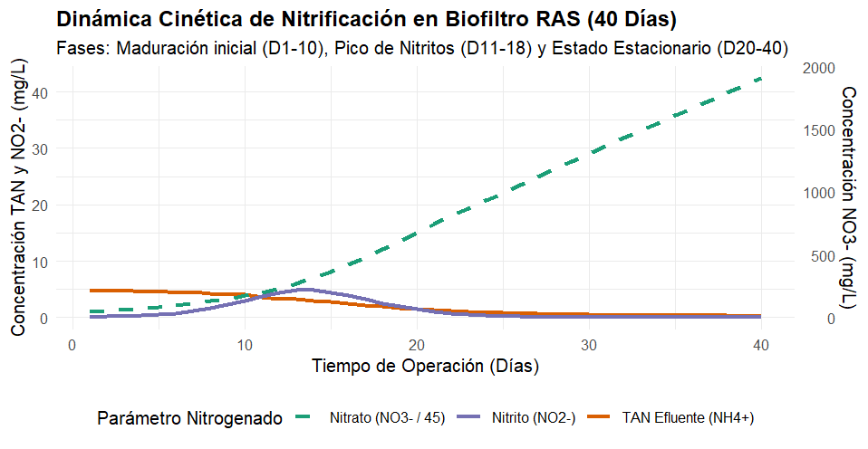
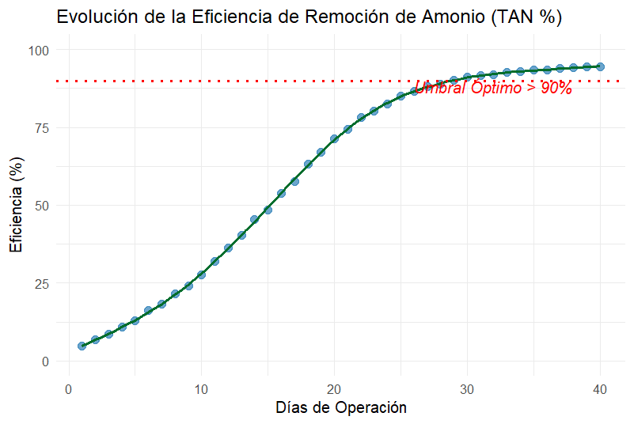

# Monitoreo Fisicoquímico y Eficiencia de Biofiltros en Sistemas RAS (40 Días)

**Autora:** Ledy Daniela Zamora Esquivel  
**Herramientas:** RStudio (`tidyverse`, `ggplot2`)  
**Área:** Biotecnología Acuícola / Calidad de Agua  

---

## 🔬 Descripción del Proyecto
Este caso de estudio evalúa la cinética de nitrificación en un sistema de recirculación acuícola (RAS) durante un periodo de maduración microbiológica de 40 días. Se analizaron variables críticas como TAN (Total Ammoniacal Nitrogen), Nitrito ($\text{NO}_2^-$), Nitrato ($\text{NO}_3^-$), pH, Temperatura y Óxigeno Disuelto para caracterizar la transición microbiológica hacia el estado estacionario.

---

## 📈 Resultados Clave

### 1. Cinética Nitrificante Completa
Se identificaron tres fases operativas bien definidas:
* **Fase 1 (Días 1-10):** Maduración inicial con TAN efluente promedio de 4.8 mg/L.
* **Fase 2 (Días 11-18):** Pico máximo de Nitritos ($\text{NO}_2^-$) alcanzando 4.90 mg/L el día 13, característico del establecimiento tardío de bacterias oxidantes de nitrito (*NOB*).
* **Fase 3 (Días 20-40):** Estado estacionario con concentración de nitritos $<0.1\text{ mg/L}$ y acumulación constante de Nitratos.

### 2. Eficiencia de Remoción de TAN (%)
* La eficiencia de conversión de amonio superó el umbral operativo óptimo del **90% a partir del día 28**, estabilizándose en **95.5% al día 40**.

---

## 📁 Archivos del Repositorio
* `ras_biofilter_data.csv`: Base de datos de monitoreo continuo (40 días).
* `analisis_ras.R`: Script automatizado en RStudio para limpieza, cálculo de ratios y generación de gráficos ggplot2.
