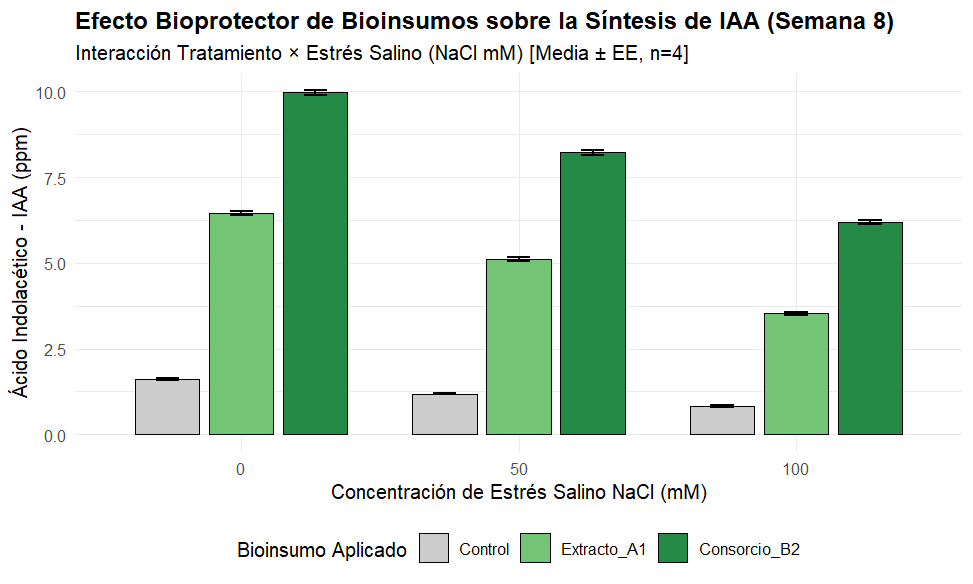
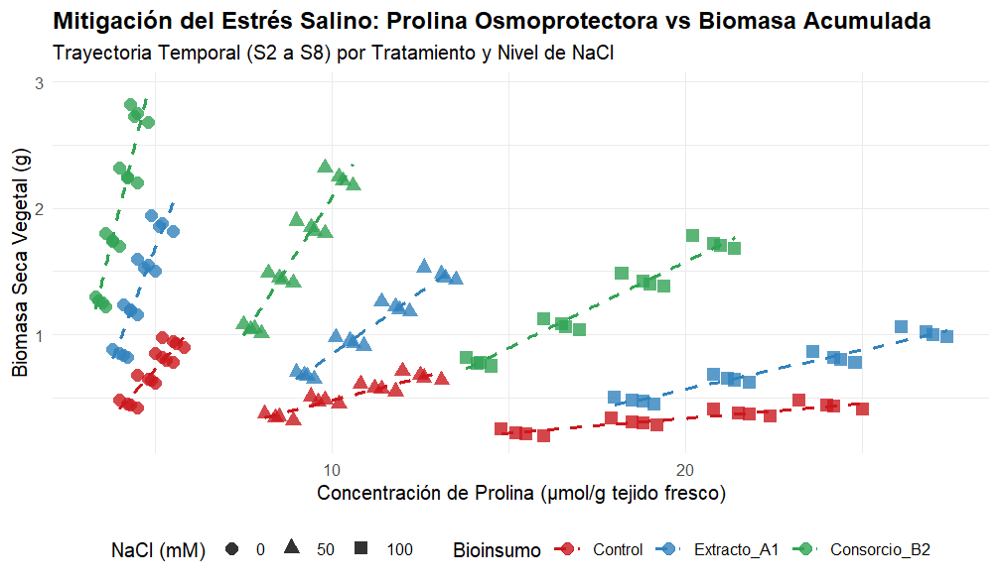

# Evaluación Factorial de Bioinsumos y Síntesis Fitohormonal (IAA/GA3) bajo Estrés Salino (8 Semanas)

**Autora:** Ledy Daniela Zamora Esquivel  
**Herramientas:** RStudio (`tidyverse`, `ggplot2`, `rstatix`)  
**Área:** Biotecnología Agrícola / Bioinsumos & Fisiología Vegetal  

---

## 🔬 Descripción del Proyecto
Este caso de estudio evalúa la respuesta fitohormonal y la tolerancia al estrés salino en plantas tratadas con bioinsumos microbianos mediante un diseño experimental factorial completo ($3 \text{ tratamientos} \times 3 \text{ niveles de NaCl} \times 4 \text{ réplicas}$). Se cuantificó la síntesis de Ácido Indolacético (IAA), Ácido Giberélico (GA3), acumulación de prolina (osmoprotector) y ganancia de biomasa seca durante un ensayo de 8 semanas en vivero.

---

## 📈 Resultados Clave

### 1. Respuesta Fitohormonal (IAA) bajo Gradiente de Salinidad
* **Efecto del Bioinsumo:** El **Consorcio Microbiano B2** incrementó la síntesis endógena de IAA en un **521%** con respecto al control bajo condiciones óptimas ($0\text{ mM NaCl}$).
* **Bioprotección ante Salinidad:** Bajo estrés salino severo ($100\text{ mM NaCl}$), el Consorcio B2 mantuvo una producción de IAA de **6.20 ppm**, atenuando la inhibición hormonal severa observada en el tratamiento control ($0.82\text{ ppm}$).

### 2. Mecanismo Osmoprotector y Recuperación de Biomasa
* **Ajuste Osmótico:** La acumulación de prolina funcionó como un bioindicador positivo de mitigación del estrés. Las plantas inoculadas con bioinsumos convirtieron el aumento de prolina en conservación efectiva de biomasa seca ($>1.70\text{ g}$ en Consorcio B2 a $100\text{ mM NaCl}$).

---

## 📁 Archivos del Repositorio
* `bioinputs_hormonal_assay.csv`: Base de datos del ensayo factorial completo ($n=144$).
* `analisis_bioinsumos.R`: Script automatizado en RStudio para ANOVA bi-factorial, pruebas de hipótesis y gráficos explicativos con ggplot2.
