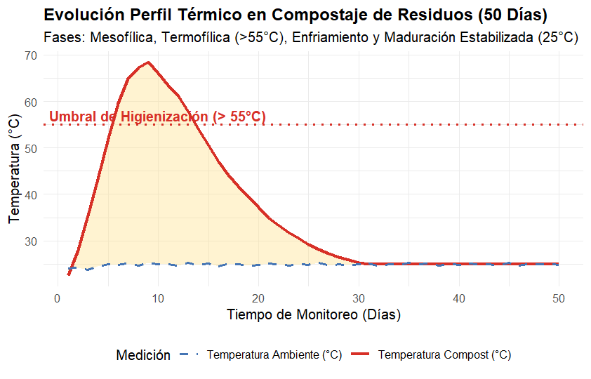
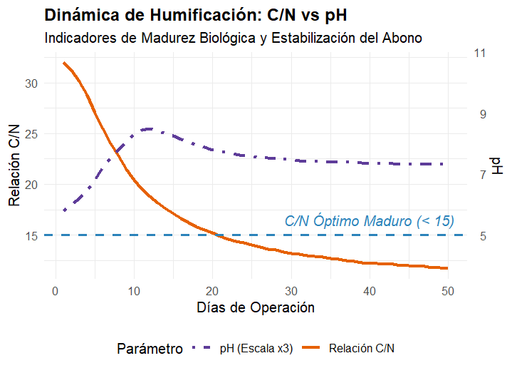

# Evaluación Cinética del Perfil Térmico y Parámetros de Maduración en Compostaje de Residuos Organicós (50 Días)

**Autora:** Ledy Daniela Zamora Esquivel  
**Herramientas:** RStudio (`tidyverse`, `ggplot2`)  
**Área:** Biotecnología Ambiental / Transformación de Residuos  

---

## 🔬 Descripción del Proyecto
Este caso de estudio analiza el perfil termodinámico y la cinética de maduración microbiológica durante la transformación de residuos orgánicos a lo largo de 50 días. Se evaluaron variables fisicoquímicas clave como Temperatura interna/ambiente (°C), relación Carbono/Nitrógeno (C/N), pH, Humedad y Conductividad Eléctrica para caracterizar la transición entre las fases biológicas y verificar el cumplimiento de los estándares normativos de higienización y humificación.

---

## 📈 Resultados Clave

### 1. Perfil Térmico e Higienización Patogénica
* **Fase Termofílica:** Transición acelerada superando el umbral crítico de higienización (**> 55 °C**) desde el día 6 hasta el día 14, con un pico máximo de **68.5 °C** el día 9.
* **Estabilización Térmica:** Tras la fase de enfriamiento (D15-D30), el material alcanzó el equilibrio térmico con la temperatura ambiente (**25 °C**) a partir del día 31, confirmando el cese de actividad metabólica mesofílica activa.

### 2. Indicadores de Madurez Biológica (C/N y pH)
* **Relación C/N:** Desciende desde un valor inicial de 32.0 hasta estabilizarse en **11.7 al día 50**, superando el umbral de humificación óptima (**C/N < 15**) desde el día 21.
* **Dinámica de pH:** Muestra alcalinización típica durante la fase termofílica por liberación de nitrógeno amoniacal (pico de **8.5**), estabilizándose en **7.3** hacia el final del proceso.

---

## 📁 Archivos del Repositorio
* `compost_kinetics_data.csv`: Serie temporal de monitoreo fisicoquímico (50 días).
* `analisis_compostaje.R`: Script automatizado en RStudio para categorización de fases térmicas, transformaciones y generación de gráficos ggplot2.
